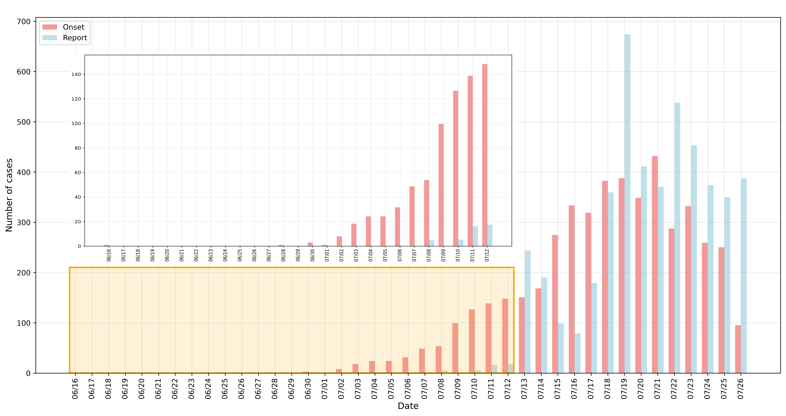
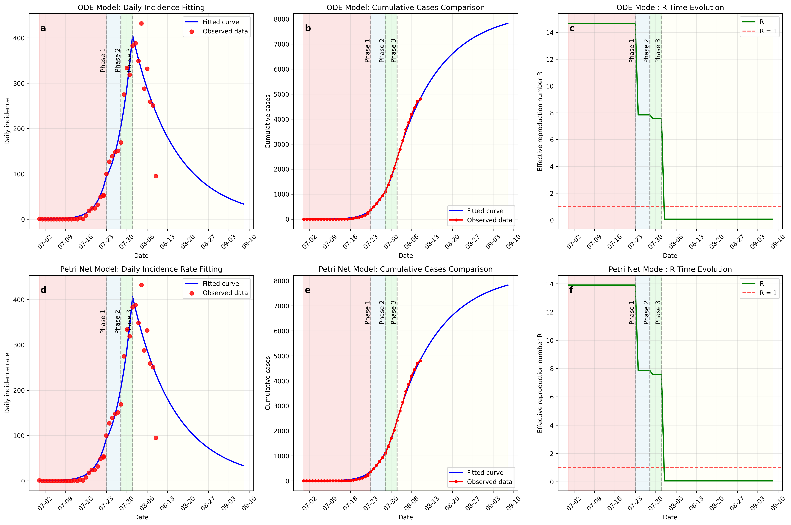
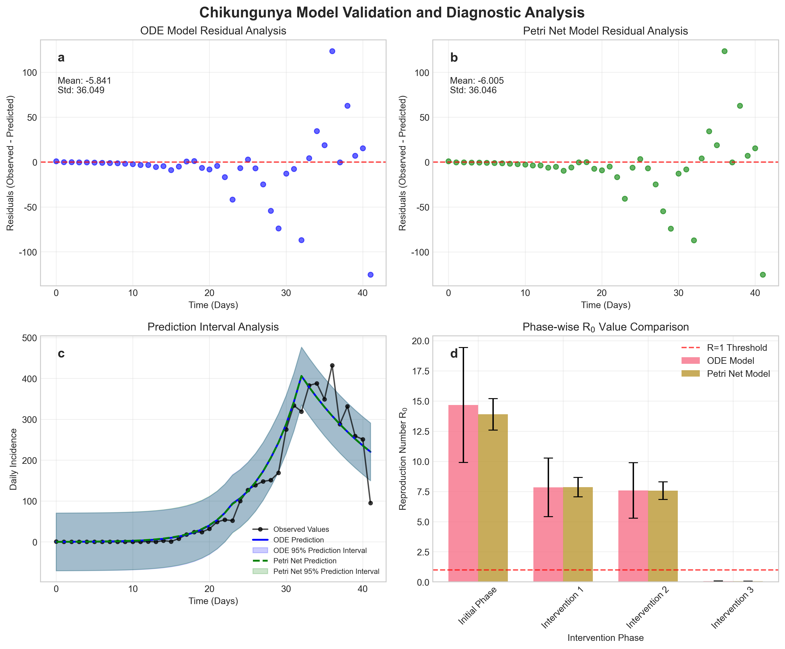
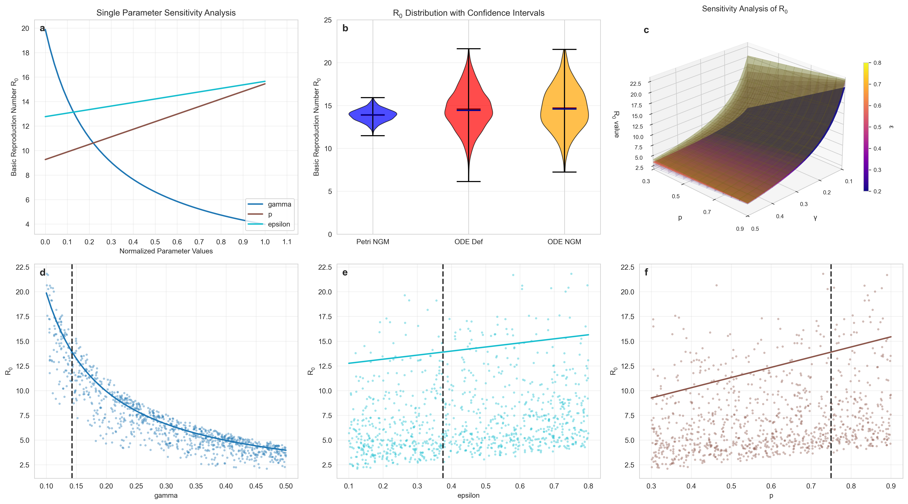

# 基孔肯雅热病毒传播建模的双模型框架：2025年佛山疫情的ODE和Petri网分析

<div align="center">

[English](README.md) | [中文](README_CN.md)

</div>

<div align="center">


</div>


本仓库是研究论文"基孔肯雅热病毒传播建模的双模型框架：2025年佛山疫情的ODE和Petri网分析"的完整代码库和数据。本研究对基孔肯雅热病毒传播动力学的常微分方程（ODE）和Petri网模型进行了全面的比较分析。

## 疫情背景

### 2025年佛山基孔肯雅热疫情概况

2025年，广东省佛山市发生了基孔肯雅热疫情。本研究通过构建基于ODE和Petri网的双模型框架，对基孔肯雅热病毒传播动力学和基本再生数估计方法进行了比较分析。研究采用SEICR（易感-暴露-感染-慢性-康复）隔室模型，特别区分了有症状感染者和无症状感染者的不同传播特征，通过三阶段拟合评估干预措施的有效性。




上图展示了佛山市2025年基孔肯雅热疫情的流行病学数据，包括每日发病数和累计病例数的时间序列，这些数据被用于模型拟合和验证。

### 疫情发展概况

2025年7月，广东省佛山市发生了基孔肯雅热疫情，疫情起源于7月8日在顺德区通过主动监测发现的输入病例。疫情迅速扩散，经过有效防控后已得到控制：

<div align="center">

| 时间节点 | 确诊病例数 | 主要分布区域 | 疫情特点 | 防控措施 |
|---------|------------|-------------|----------|----------|
| 7月19日 | 1,873例 | 顺德区1,790例，禅城区49例，南海区34例 | 主要集中在顺德区乐从、北滘、陈村等镇 | 早期监测和病例发现 |
| 7月22日 | 2,934例 | 仅顺德区 | 疫情继续增长，并波及澳门特别行政区 | 加强监测 |
| 7月30日 | 5,158例 | 广东省累计，佛山市占93% | 启动Ⅲ级响应，覆盖53个镇街 | 启动Ⅲ级响应，指定53家定点医院，提供3,696张防蚊隔离床位 |
| 8月25日 | 连续9天<50例/天 | 多区域分布 | 疫情进入低水平散发状态 | 持续监测，维持防控措施 |
| 8月26日 | 终止Ⅲ级响应 | 全市范围 | 防控转为常态化，实现社会面清零 | 终止Ⅲ级响应，防控策略转为常态化 |
| 9月14-20日 | 0例新增 | 全市范围 | 连续无新增病例，疫情得到有效控制 | 蚊媒密度降至安全水平，社会活动恢复正常 |

</div>

### 三阶段干预措施

基于官方时间线和实施的控制措施，本研究将疫情分为四个阶段进行建模：

<div align="center">

| 阶段 | 时间范围 | 传播率 | 主要干预措施 |
|------|---------|--------|-------------|
| 初始阶段 | 2025-06-16 至 2025-07-09 | β₀ | 无控制措施，自然传播 |
| 阶段1 | 2025-07-09 至 2025-07-14 | β₁ | 早期监测和病例发现 |
| 阶段2 | 2025-07-14 至 2025-07-18 | β₂ | 医疗机构启动核酸检测 |
| 阶段3 | 2025-07-18之后 | β₃ | 集中清理蚊虫孳生地 |

</div>


## 研究概述

### 研究摘要

本研究针对2025年中国广东省佛山市基孔肯雅热疫情，构建了基于常微分方程（ODE）和Petri网（PN）的双模型框架，用于比较分析基孔肯雅热传播动力学和再生数估计方法。研究采用SEICR（易感-暴露-感染-慢性-康复）隔室建模，在相同流行病学情景下建立两种不同建模方法的比较分析，并通过三阶段干预拟合协议评估疫情控制措施的及时性。

模型验证结果显示，ODE和Petri网模型均表现出优秀的准确性和一致性，平均绝对误差（MAE）分别为18.77和18.91例，均方根误差（RMSE）分别为36.52和36.54例。两个模型均预测疫情在第32天达到峰值（406例），比观察到的第35天峰值（432例）提前3天，峰值预测误差为6.0%。

再生数分析显示，初始基本再生数（R₀）约为14.67（ODE）/13.90（PN），有效再生数（R_eff）通过三个干预阶段逐步下降：阶段1后为7.85/7.86，阶段2后为7.59/7.56，最终在阶段3达到0.059，成功实现疫情传播阻断。

敏感性分析表明，康复率（γ）是影响R₀的最敏感参数，Sobol指数为0.9672，解释了R₀总变异的96.72%，表明优化临床治疗和加速患者康复构成最有效的疫情控制策略。本研究首次对ODE和Petri网模型进行系统性数值比较，为基孔肯雅热等虫媒疾病建模提供了新颖的双模型分析框架，对疫情预防控制策略制定具有重要的理论指导意义和实用价值。

### 三阶段干预拟合



### 主要亮点
- **双模型比较**：首次对ODE和Petri网模型进行系统性数值比较。
- **拟合效果**：两个模型都实现优秀的拟合性能（MAE：18.77/18.91例，RMSE：36.52/36.54例）。
- **有效干预**：三阶段控制措施成功将有效再生数从14.7降低到0.059。
- **综合分析**：包括敏感性分析、置信区间和不确定性量化。
- **数据提取**：通过OpenCV图像处理技术从官方图表中自动提取病例数据，实现数据开源共享。


### 疫情控制效果

通过三阶段干预措施的实施，疫情得到了有效控制：

- **阶段1效果**：传播系数从β₀降低到β₁，减少约47%
- **阶段2效果**：传播系数进一步降低到β₂，累计减少约48%  
- **阶段3效果**：传播系数大幅降低到β₃，累计减少99%，有效再生数降至0.059


### 模型性能

- **峰值预测**：两个模型都预测第32天达到峰值（406例），而观察到的峰值在第35天（432例），峰值预测误差为6.0%。
- **控制时间线**：模型预测第65天实现疫情控制（每日病例数<0.1）。

### 再生数

- **初始R₀**：ODE 14.67 vs Petri网 13.90
- **阶段1 R_eff**：7.85 vs 7.86
- **阶段2 R_eff**：7.59 vs 7.56
- **阶段3 R_eff**：0.059 vs 0.059

### 敏感性分析

- **最敏感参数**：康复率（γ）是最具影响力的参数，Sobol指数为0.9672。
- **方差解释**：γ解释了R₀方差的96.72%。
- **关键洞察**：加速患者康复是最有效的控制策略。


## 模型验证与敏感性分析



上图展示了基孔肯雅热流行病学模型的综合验证和诊断分析结果，比较了常微分方程（ODE）模型和Petri网模型在残差分析、预测区间和分阶段再生数（R₀）比较方面的性能。子图包括：(a) ODE模型残差分析，(b) Petri网模型残差分析，(c) 预测区间分析，(d) 分阶段R₀值比较。

子图(a)和(b)分别显示了ODE模型和Petri网模型的残差分布（观测值-预测值）。两个模型的残差统计如下：ODE模型残差均值为-5.841，标准差为36.049；Petri网模型残差均值为-6.005，标准差为36.046。两个模型在残差中表现出相似的系统性模式，而非理想的随机白噪声特征。在疫情早期阶段（约前20天），残差接近零，表明模型拟合良好。然而，在疫情峰值期间（约第20-35天），残差系统性变为负值，随后出现大的正波动。这种非随机模式表明模型可能未能完全捕捉干预措施或其他外部因素引起的动态变化，特别是在疫情下降阶段，模型预测表现出系统性偏差，低估了政府疫情控制措施取得的超额效果。

子图(c)比较了两个模型的预测轨迹及其95%预测区间。绝大多数观测值落在两个模型相似的95%预测区间内，验证了模型的预测能力。子图(d)比较了四个不同阶段（初始阶段和三个干预阶段）的再生数R₀估计值。两个模型一致地揭示了R₀值随干预措施实施的阶段性下降趋势。初始阶段R₀值显著高于1.0，表明疫情快速传播。随后的干预措施显著降低了R_eff值，最终在第三个干预阶段实现R_eff < 1.0，标志着有效的疫情传播控制。



上图展示了参数敏感性分析结果的可视化。(a) 单参数敏感性分析显示了康复率（γ）、有症状概率（p）和相对无症状传染性（ε）对基本再生数（R₀）的影响。(b) 不同计算方法下R₀值的分布和置信区间。(c) 康复率（γ）和有症状概率（p）相对于R₀的三维敏感性曲面。(d-f) 分别为γ、ε和p的散点图和趋势线。

上图通过六个子图直观地验证了定量结果。子图(a)显示γ曲线最陡峭且呈非线性下降，表明R₀对γ具有高敏感性。相比之下，p和ε显示线性温和增长，敏感性较低，而p曲线比ε曲线表现出更陡峭的线性梯度。子图(b)呈现小提琴图，显示三种方法产生相似的R₀均值，但揭示了不同的分布模式和置信区间。子图(c)显示三维曲面，当γ较低且p较高时R₀值最大，随着γ增加或p减少，R₀快速下降，从而提供了参数交互的多维视角。子图(d-f)将单参数敏感性分析与多参数蒙特卡洛采样结果相结合：曲线代表使用Petri网下一代矩阵法在50个参数值点进行的系统性R₀计算，而散点表示来自1000次多参数蒙特卡洛采样运行的实验数据，参数值随机分配。这些散点图确认了定量分析结论，即γ与R₀呈强负相关，而ε和p与R₀呈中等正相关。

总之，康复率γ代表了控制基孔肯雅热传播的核心参数。因此，旨在加速患者康复的干预策略将产生最显著的疫情控制效果。


## 数据预览

### 数据提取方法

本研究使用`data/data_extract.py`脚本，通过OpenCV图像处理技术从佛山市卫生部门发布的官方流行病学图表中自动提取每日发病数据。该方法采用HSV色彩空间检测，能够准确识别图表中的蓝色和红色柱状图，并自动计算其几何属性。

### 提取数据概览

从`foshan_chikungunya_outbreak_epidemiological_data_2025.csv`文件中提取的疫情数据包含以下关键信息：

<div align="center">

| 日期 | 发病病例数 | 报告病例数 | 数据类型 | 备注 |
|------|------------|------------|----------|------|
| 2025-06-16 | 1 | - | 发病日期 | 首例病例 |
| 2025-06-28 | 1 | - | 发病日期 | - |
| 2025-06-30 | 3 | - | 发病日期 | - |
| 2025-07-01 | 1 | - | 发病日期 | - |
| 2025-07-02 | 8 | - | 发病日期 | - |
| 2025-07-08 | 54 | 5 | 发病/报告 | 疫情通报 |
| 2025-07-09 | 100 | 0 | 发病/报告 | 加强病例管理和媒介控制措施 |
| 2025-07-14 | 169 | 190 | 发病/报告 | 医疗机构启动核酸检测 |
| 2025-07-18 | 383 | 360 | 发病/报告 | 三天集中清理蚊虫孳生地 |
| 2025-07-19 | 388 | 674 | 发病/报告 | 报告病例数达到峰值 |
| 2025-07-21 | 432 | 371 | 发病/报告 | 发病病例数达到峰值 |
| 2025-07-26 | 95 | 387 | 发病/报告 | 发病数开始下降 |

</div>


### 开源数据文件

- **主数据文件**：`foshan_chikungunya_outbreak_epidemiological_data_2025.csv`
- **提取脚本**：`data/data_extract.py`
- **数据格式**：CSV格式，包含日期、病例数、数据类型等字段

## 结果复现

- Python 3.8+
- 所需包列在`requirements.txt`中：

```bash
pip install -r requirements.txt
```

## SEICR模型

### ODE模型

我们采用SEICR模型，状态为$(S,E,I_s,I_a,C,R)$。感染力为$\lambda = \beta S (I_s + \epsilon I_a)/N$，其中$\epsilon$是无症状感染的相对传染性。动力学遵循我们文档中描述的平衡方程，包括人口流入/流出和转移速率$\sigma,\gamma,\omega,\mu, p, q$。

控制SEICR模型动力学的常微分方程组为：

$$
\begin{align}
\frac{dS}{dt} &= \Lambda - \lambda S - \mu S \\
\frac{dE}{dt} &= \lambda S - \sigma E - \mu E \\
\frac{dI_s}{dt} &= p\sigma E - \gamma I_s - \mu I_s \\
\frac{dI_a}{dt} &= (1-p)\sigma E - \gamma I_a - \mu I_a \\
\frac{dC}{dt} &= q\gamma I_s - \omega C - \mu C \\
\frac{dR}{dt} &= (1-q)\gamma I_s + \gamma I_a + \omega C - \mu R
\end{align}
$$

其中感染力定义为：

$$
\lambda = \frac{\beta S (I_s + \epsilon I_a)}{N}
$$

总人口满足：

$$
N = S + E + I_s + I_a + C + R
$$

模型参数定义如下：$\Lambda$是人口出生/移民率，$\mu$是自然死亡率，$\beta$是传播率，$\epsilon$是无症状感染的相对传染性，$\sigma$是暴露转移率，$p$是暴露个体中有症状的比例，$\gamma$是急性康复率，$q$是有症状个体进展到慢性期的比例，$\omega$是慢性康复率。

### Petri网模型构建

基于Petri网在流行病学建模中的上述优势，我们构建了一个与SEICR ODE模型相当的Petri网实现。该PN模型包含对应于SEICR隔室的位置和表示感染、进展、康复、死亡和出生过程的转移。变速率转移实现与ODE项相同的速率函数，确保结构相似性。

Petri网模型可以正式定义为六元组$PN = (P, T, F, W, M_0, \Lambda)$，符号解释如下：

<div align="center">

| 符号 | 定义 | 描述 |
|------|------|------|
| $P$ | $\{S, E, I_s, I_a, C, R\}$ | 位置集合，对应于SEICR模型的六个隔室 |
| $T$ | $\{t_{inf}, t_{exp\_s}, t_{exp\_a}, t_{rec\_s}, t_{rec\_a}, t_{chr}, t_{rec\_c}, t_{birth}, t_{death}\}$ | 转移集合，表示所有状态转移过程 |
| $F$ | $\subseteq (P \times T) \cup (T \times P)$ | 流关系，定义位置和转移之间的连接 |
| $W$ | $F \rightarrow \mathbb{R}^+$ | 权重函数，定义弧权重 |
| $M_0$ | $P \rightarrow \mathbb{N}$ | 初始标记，表示每个隔室中的初始人口 |
| $\Lambda$ | $T \rightarrow \mathbb{R}^+$ | 转移速率函数，定义每个转移的激发速率 |

</div>

每个转移的速率函数与ODE模型中相应的项保持一致：

<div align="center">

| 转移 | 速率函数 | 描述 |
|------|----------|------|
| $t_{inf}$ | $\lambda_{inf}(t) = \frac{\beta(t) S(t) (I_s(t) + \epsilon I_a(t))}{N(t)}$ | 感染转移 |
| $t_{exp\_s}$ | $\lambda_{exp\_s}(t) = p\sigma E(t)$ | 暴露到有症状感染的转移 |
| $t_{exp\_a}$ | $\lambda_{exp\_a}(t) = (1-p)\sigma E(t)$ | 暴露到无症状感染的转移 |
| $t_{rec\_s}$ | $\lambda_{rec\_s}(t) = (1-q)\gamma I_s(t)$ | 有症状感染到慢性的转移 |
| $t_{chr}$ | $\lambda_{chr}(t) = q\gamma I_s(t)$ | 有症状感染直接康复转移 |
| $t_{rec\_a}$ | $\lambda_{rec\_a}(t) = \gamma I_a(t)$ | 无症状感染康复转移 |
| $t_{rec\_c}$ | $\lambda_{rec\_c}(t) = \omega C(t)$ | 慢性患者康复转移 |
| $t_{birth}$ | $\lambda_{birth}(t) = \Lambda$ | 人口出生转移 |
| $t_{death}$ | $\lambda_{death}(t) = \mu N(t)$ | 自然死亡转移 |

</div>

$$
\begin{align}
\lambda_{inf}(t) &= \frac{\beta(t) S(t) (I_s(t) + \epsilon I_a(t))}{N(t)} \\
\lambda_{exp\_s}(t) &= p\sigma E(t) \\
\lambda_{exp\_a}(t) &= (1-p)\sigma E(t) \\
\lambda_{rec\_s}(t) &= (1-q)\gamma I_s(t) \\
\lambda_{chr}(t) &= q\gamma I_s(t) \\
\lambda_{rec\_a}(t) &= \gamma I_a(t) \\
\lambda_{rec\_c}(t) &= \omega C(t) \\
\lambda_{birth}(t) &= \Lambda \\
\lambda_{death}(t) &= \mu N(t)
\end{align}
$$

### 基本再生数（R₀）计算

基本再生数（R₀）是理解传播潜力的关键指标。我们使用两种方法进行交叉验证计算。

#### 定义方法

该方法基于定义R₀ = β ×（有效传染期）。

$$
R_0 = \beta \times T_{eff}
$$

其中有效传染期$T_{eff}$为：

$$
T_{eff} = p \times \frac{1}{\gamma_s} + (1-p) \times \epsilon \times \frac{1}{\gamma_a}
$$

根据定义方法，只有$I_s$（有症状感染个体）和$I_a$（无症状感染个体）对后续传播有贡献。典型初始个体产生的预期继发病例数可以通过路径比例和相对传染性进行加权。当存在自然死亡率$\mu$时，定义方法得出：

$$
R_{\mathrm{def}}(\beta) = \beta\,\frac{\sigma}{\sigma+\mu}\left( \frac{p}{\gamma+\mu} + \frac{(1-p)\,\epsilon}{\gamma+\mu} \right)
$$

其中因子$\sigma/(\sigma+\mu)$反映从潜伏期到传染期的存活比例，$1/(\gamma+\mu)$表示$I_s$和$I_a$的平均传染期。对于短期疫情持续时间或当$\mu\ll \sigma,\gamma$时，上式近似为常用表达式：

$$
R_{\mathrm{def}}(\beta) \approx \beta\left( \frac{p}{\gamma} + \frac{(1-p)\,\epsilon}{\gamma} \right)
$$

#### 下一代矩阵法

基于下一代矩阵K = FV⁻¹的谱半径，其中F是新感染矩阵，V是转移矩阵。

##### ODE的下一代矩阵法

对于ODE中的下一代矩阵（NGM）方法，我们首先在无病平衡点（DFE）处线性化系统，其中$(S^*,E^*,I_s^*,I_a^*,C^*,R^*) = (N,0,0,0,0,0)$。无病平衡点表示人群中不存在感染的状态，其中易感人群等于总人口，所有传染隔室为空。这个平衡点作为线性化和再生数计算的参考点。

设传染子系统为$(E,I_s,I_a)$，定义新感染矩阵和转移矩阵为：

$$
F = \begin{pmatrix}
0 & \beta & \beta\,\epsilon\\
0 & 0 & 0\\
0 & 0 & 0
\end{pmatrix},\qquad
V = \begin{pmatrix}
\sigma+\mu & 0 & 0\\
-p\,\sigma & \gamma+\mu & 0\\
-(1-p)\,\sigma & 0 & \gamma+\mu
\end{pmatrix}
$$

下一代矩阵为$K=FV^{-1}$，再生数是其谱半径$R_{\mathrm{NGM}}=\rho(K)$。

##### Petri网的下一代矩阵法

在Petri网中，下一代矩阵法的构建基于相同的传染子系统$(E,I_s,I_a)$。无病平衡点（DFE）在Petri网框架中对应于标记向量$m^*=(N,0,0,0,0,0)$，表示易感位置包含整个人群，而所有与感染相关的位置为空。

对于传染子系统$(E,I_s,I_a)$，Petri网的雅可比矩阵$J$在DFE处分解为$J=F-V$，其中：

$$
F^{\mathrm{PN}} = \begin{pmatrix}
0 & \beta & \beta\,\epsilon\\
0 & 0 & 0\\
0 & 0 & 0
\end{pmatrix},\qquad
V^{\mathrm{PN}} = \begin{pmatrix}
\sigma+\mu & 0 & 0\\
-p\,\sigma & \gamma+\mu & 0\\
-(1-p)\,\sigma & 0 & \gamma+\mu
\end{pmatrix}
$$

矩阵$F^{\mathrm{PN}}$的构建基于Petri网中新感染转移的速率函数：从易感$S$到暴露$E$的感染转移$t_{\mathrm{inf}}$，速率函数为$\lambda_{\mathrm{inf}}(t) = \beta(t) S(t) (I_s(t) + \epsilon I_a(t))/N(t)$。在$S \approx N$的DFE处，$F^{\mathrm{PN}}$的非零元素对应于感染转移相对于$I_s$和$I_a$的偏导数。

因此，Petri网框架中的下一代矩阵为$K^{\mathrm{PN}} = (F^{\mathrm{PN}})(V^{\mathrm{PN}})^{-1}$，基本再生数为$R_{\mathrm{NGM}}^{\mathrm{PN}} = \rho(K^{\mathrm{PN}})$。

### 95%置信区间结果

<div align="center">

| 阶段   | ODE（定义法）        | ODE（下一代矩阵法）    | Petri网（下一代矩阵法）    | 传播减少率 |
| ------ | -------------------- | -------------------- | -------------------- | ---------- |
| 初始   | 14.67 [11.30, 20.82] | 14.67 [11.29, 20.81] | 13.90 [12.59, 15.30] | -          |
| 阶段1  | 7.85 [6.07, 10.93]   | 7.84 [6.07, 10.92]   | 7.86 [7.07, 8.65]    | 46.5%      |
| 阶段2  | 7.59 [5.86, 10.45]   | 7.59 [5.85, 10.45]   | 7.56 [6.85, 8.35]    | 48.3%      |
| 阶段3  | 0.059 [0.046, 0.082] | 0.059 [0.046, 0.082] | 0.059 [0.053, 0.065] | 99.6%      |

</div>


### 模型参数

#### 人口学参数

<div align="center">

| 参数 | 符号 | 值 | 单位 | 含义 |
|------|------|-----|------|------|
| 总人口 | $N$ | 9,615,400 | 人 | 佛山常住人口（2023年） |
| 出生率 | $\Lambda$ | 317 | 人/天 | 人类出生或净移民率 |
| 死亡率 | $\mu$ | 1.504×10⁻⁵ | 天⁻¹ | 自然人类死亡率 |

</div>

Lambda（每日出生/净移民）和mu（每日死亡率）的计算基于佛山市2024年人口统计数据。

#### 疾病进展参数

<div align="center">

| 参数 | 符号 | 值 | 单位 | 含义 |
|------|------|-----|------|------|
| 潜伏期倒数 | $\sigma$ | 0.2 | 天⁻¹ | 平均潜伏期5天 |
| 有症状比例 | $p$ | 0.75 | 无量纲 | 75%的感染个体有症状 |
| 有症状康复率 | $\gamma_s$ | 0.143 | 天⁻¹ | 平均有症状传染期7天 |
| 无症状康复率 | $\gamma_a$ | 0.143 | 天⁻¹ | 平均无症状传染期7天 |
| 慢性化比例 | $q$ | 0.43 | 无量纲 | 43%的有症状患者发展为慢性阶段 |
| 慢性康复率 | $\omega$ | 0.0026 | 天⁻¹ | 平均慢性期385天 |

</div>

#### 传播参数

<div align="center">

| 参数 | 符号 | 值 | 单位 | 含义 |
|------|------|-----|------|------|
| 有效传播率 | $\beta$ | 0.9470 | 天⁻¹ | 基于三阶段干预拟合的最优值 |
| 无症状相对传播性 | $\epsilon$ | 0.375 | 无量纲 | 无症状传播性是有症状的37.5% |

</div>

`epsilon`参数（无症状感染的相对传播性）从0.1更新为0.375，有科学证据和计算过程支持。这一变化影响了模型的`beta`值和三阶段干预拟合结果，达到了R²=0.941。计算基于病毒载量差异和蚊子感染概率等生物学数据，该值通过其他研究和三阶段拟合模型得到验证。


# 贡献

我们欢迎贡献！无论是模型扩展和改进，额外的验证研究或者应用于其他疫情。

如果对文章或者markdown说明存在疑惑或者发现错误，欢迎通过[GitHub Issues](https://github.com/Hylouis233/ODE-Petri-Chikungunya/issues)提出。

## 引用

如果您使用此工作，请引用：

```bibtex
@article{liu2025dual,
  title={Dual-Model Framework for CHIKV Transmission Modeling: ODE and Petri Net Analysis of the 2025 Foshan Outbreak},
  author={Liu, Hong and Tian, Jingjing and Tang, Sheng and Yang, Zifeng},
  journal={arXiv preprint arXiv:XXXX.XXXXX},
  year={2025},
  note={Under review}
}
```

### 数据引用

如果您仅使用本项目的开源数据，请引用：

```bibtex
@dataset{liu2025foshan,
  title={Foshan Chikungunya Outbreak Epidemiological Data 2025},
  author={Liu, Hong and Tian, Jingjing and Tang, Sheng and Yang, Zifeng},
  year={2025},
  publisher={Zenodo},
  doi={xx.xxxx/zenodo.XXXXXXX},
  url={https://doi.org/xx.xxxx/zenodo.XXXXXXX}
}
```
